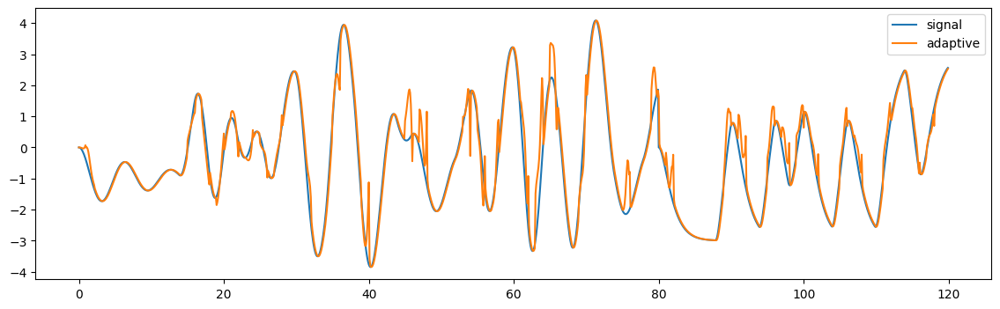
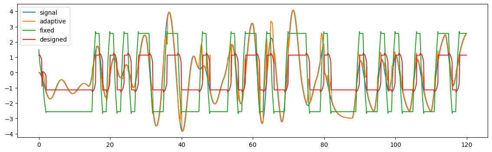
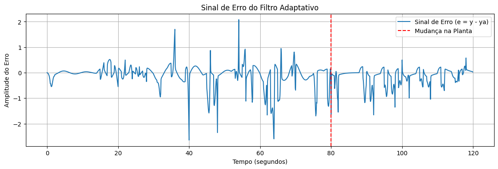

# Identificação de sistemas com ADALINE

Como um modelo acompanha um sistema que muda durante a operação? Neste experimento, uma rede ADALINE ajusta os pesos de um filtro FIR enquanto recebe novas amostras de entrada e saída. A comparação é feita com dois modelos de pesos fixos.



Figura extraída do [relatório do projeto](170072274_adaline.pdf), página 5. Configuração: 11 coeficientes e taxa de aprendizagem de 0,084848.

## O experimento

Trabalho de Inteligência Computacional da Universidade de Brasília, a partir do roteiro do professor Adolfo Bauchspiess. A implementação usa **Python, NumPy, SciPy e Matplotlib**.

O sistema começa com `G1(s) = 1 / (s² + 0,2s + 1)` e, aos 80 segundos, passa para `G2(s) = 3 / (s² + 2s + 1)`. A simulação vai até 119,9 s, com amostragem de 0,1 s. O notebook calcula as versões discretas por retenção de ordem zero e usa `signal.lsim` para gerar a resposta das plantas, levando o estado final do primeiro trecho para o segundo.

A entrada é um sinal binário pseudoaleatório (PRBS). Há duas bandas disponíveis no arquivo de dados: de 0 a 0,01 e de 0 a 0,05 da frequência de Nyquist. Isso permite observar como a variação da entrada interfere na identificação.

## Comparação dos modelos

| Modelo | Como os pesos são definidos |
| --- | --- |
| ADALINE adaptativo | Atualizados a cada amostra pela regra LMS/Widrow-Hoff |
| Pesos finais fixos | Obtidos ao fim do treinamento adaptativo e reutilizados em toda a simulação |
| Solução em lote (`newlind`) | Calculados de uma vez a partir de todo o conjunto, por equações normais de mínimos quadrados |



Figura extraída da página 5 do relatório. As legendas originais são `signal`, `adaptive`, `fixed` e `designed`.

Na execução salva no notebook, `delays = 11`, `mu = 0.084848` e `band = '05'` produziram **MSE de aproximadamente 0,1769** para o filtro adaptativo. Esse é um resultado registrado no arquivo, não uma nova medição nem uma garantia de melhor configuração fora do experimento.

O resultado discutido no relatório é que o filtro adaptativo acompanha melhor a mudança da planta. O modelo que conserva os pesos finais se ajusta melhor ao trecho final, enquanto a solução em lote procura um único conjunto de pesos para dois regimes diferentes.



Saída gráfica preservada do notebook original.

## Abrir e executar

No PowerShell, com Python instalado:

```powershell
git clone https://github.com/WmsTech/Redes-Neurais---ADALINE.git
cd Redes-Neurais---ADALINE
python -m venv .venv
.\.venv\Scripts\python -m pip install numpy scipy matplotlib notebook
.\.venv\Scripts\python -m notebook
```

Abra [`adaline_identificacao_de_sistema/Ex2-IC_UnB.ipynb`](adaline_identificacao_de_sistema/Ex2-IC_UnB.ipynb) e execute as células na ordem. O kernel deve trabalhar na pasta do notebook, onde está [`idinp.csv`](adaline_identificacao_de_sistema/idinp.csv).

Os parâmetros `delays`, `mu` e `band` ficam na primeira célula. A busca de parâmetros da última célula está desativada por uma condição; ela precisa ser ajustada para repetir a busca, que envolve muitas simulações.

## Material e continuidade

- [Relatório de Washington Marinho dos Santos](170072274_adaline.pdf), com metodologia, resultados e discussão.
- [Roteiro da disciplina](adaline_identificacao_de_sistema_roteiro.pdf), com a proposta do exercício.

Antes de ampliar os experimentos, vale revisar o alinhamento da linha de atrasos entre os métodos e substituir a inversão explícita da matriz por uma solução numérica mais estável. Também falta registrar uma comparação de MSE por trecho, antes e depois dos 80 s.

O notebook parte do material didático identificado como IC/UnB, de Adolfo Bauchspiess. O relatório e os experimentos apresentados neste repositório são de Washington Marinho dos Santos.
